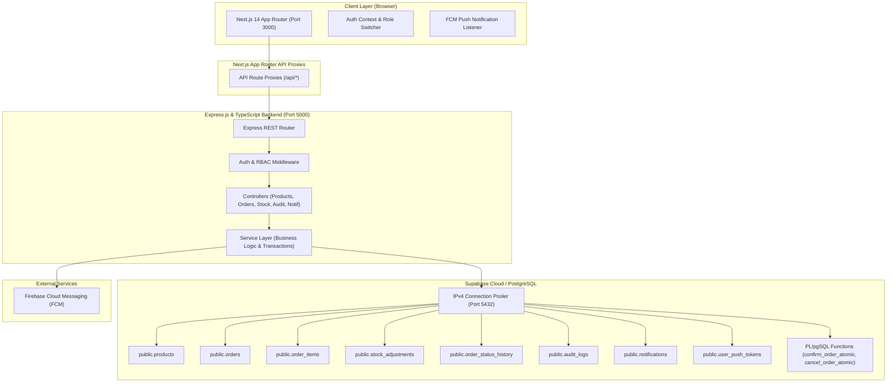

# System Architecture & Technical Specification
## Real-Time Inventory & Order Reservation System

### 1. High-Level System Architecture



---

### 2. Database Schema & Entity-Relationship Model

```mermaid
erDiagram
    products ||--o{ order_items : "referenced in"
    products ||--o{ stock_adjustments : "adjusted by"
    orders ||--|{ order_items : "contains"
    orders ||--o{ order_status_history : "tracks lifecycle"
    orders ||--o{ audit_logs : "audited"

    products {
        text id PK "UUID or text identifier"
        text sku UK "Unique Stock Keeping Unit"
        text name "Product display name"
        numeric unit_price "Authoritative unit price"
        integer available_quantity "Current available stock"
        integer low_stock_threshold "Threshold for warning alerts"
        boolean is_active "Soft deactivation flag"
        timestamptz created_at "Creation timestamp"
        timestamptz updated_at "Last updated timestamp"
    }

    orders {
        text id PK "Order identifier (ORD-2026-XXXX)"
        text status "pending | confirmed | fulfilled | cancelled"
        integer total_quantity "Server-computed total units"
        numeric total_amount "Server-authoritative monetary total"
        text created_by "Creator email"
        text created_by_role "admin | staff"
        text idempotency_key UK "Client deduplication token"
        timestamptz created_at "Order submission timestamp"
        timestamptz updated_at "State transition timestamp"
    }

    order_items {
        uuid id PK "Item UUID"
        text order_id FK "References orders(id)"
        text product_id FK "References products(id)"
        text sku "Snapshot SKU at creation"
        text name "Snapshot product name"
        numeric unit_price "Authoritative unit price"
        integer quantity "Ordered units"
        numeric line_total "Server-calculated total (unit_price * qty)"
        timestamptz created_at "Created timestamp"
    }

    stock_adjustments {
        uuid id PK "Adjustment UUID"
        text product_id FK "References products(id)"
        text product_sku "Product SKU"
        text product_name "Product name"
        text acting_user "Operator email"
        text acting_role "admin | staff"
        integer quantity_change "Positive restock or negative deduction"
        text reason "Mandatory operational explanation"
        timestamptz created_at "Timestamp of adjustment"
    }

    order_status_history {
        uuid id PK "History entry UUID"
        text order_id FK "References orders(id)"
        text previous_status "Previous order status"
        text new_status "Transitioned order status"
        text actor_email "Acting user email"
        text actor_role "Acting user role"
        text note "Operational details"
        timestamptz created_at "Transition timestamp"
    }

    audit_logs {
        uuid id PK "Audit log UUID"
        timestamptz timestamp "Event timestamp"
        text actor_email "Operator email"
        text actor_role "admin | staff | viewer"
        text action "ORDER_CREATED | ORDER_CONFIRMED | STOCK_ADJUSTMENT | etc."
        text entity_type "product | order | stock"
        text entity_id "Entity identifier"
        text entity_reference "Readable reference (e.g. SKU or Order ID)"
        text details "Human-readable summary of change"
        integer quantity_change "Optional numeric shift"
        text reason "Mandatory reason if applicable"
    }

    notifications {
        uuid id PK "Notification UUID"
        text event_id UK "Unique event hash for deduplication"
        text title "Notification title"
        text message "Notification body"
        text type "low_stock | order_status | stock_adjustment | system"
        text reference_id "Related entity ID"
        text reference_type "product | order"
        boolean read "Read status flag"
        timestamptz created_at "Created timestamp"
    }

    user_push_tokens {
        uuid id PK "Token record UUID"
        text user_email "User email"
        text token UK "FCM device registration token"
        timestamptz created_at "Registration timestamp"
    }
```



---

### 3. Transaction Strategy & Concurrency Safety

#### 3.1 The Concurrency Challenge
When multiple staff members confirm orders simultaneously for scarce stock (e.g., 2 orders requesting 4 units when only 5 exist), standard application-level checks cause race conditions where both requests see sufficient inventory and deduct stock, resulting in negative available quantity (overselling).

#### 3.2 Solution: Deterministic Row Locks & PL/pgSQL Atomic Procedures
The system employs deterministic row-level locks via PostgreSQL transactions and stored procedures (`confirm_order_atomic` and `cancel_order_atomic`):

1. **Order Exclusivity Lock**:
   ```sql
   SELECT * INTO v_order FROM public.orders WHERE id = p_order_id FOR UPDATE;
   ```
   Prevents concurrent status transitions on the same order.

2. **Deterministic Multi-Product Row Locks**:
   ```sql
   PERFORM 1 FROM public.products
   WHERE id IN (SELECT product_id FROM public.order_items WHERE order_id = p_order_id)
   ORDER BY id
   FOR UPDATE;
   ```
   - Ordering by `id` guarantees that overlapping orders acquire locks in identical sequence, eliminating deadlock risk across concurrent transactions.

3. **All-or-Nothing Stock Verification**:
   - The procedure loops through all line items and validates `available_quantity >= requested_quantity`.
   - If any single item lacks stock, the entire transaction is rolled back cleanly with an exception:
     ```
     INSUFFICIENT_STOCK: Product ... has only X units available, but Y were requested
     ```
   - No partial deductions take place across any line item.

4. **Exact-Once Order Cancellation Safeguard**:
   - When cancelling an order (`cancel_order_atomic`):
     - If the order was in `confirmed` status: stock was previously reserved, so the procedure restores the reserved units to `available_quantity`.
     - If the order was in `pending` status: stock was never reserved, so zero stock is released (preventing phantom inventory creation).
     - If the order is already cancelled: rejects with `ORDER_ALREADY_CANCELLED` (`400 Bad Request`).

---

### 4. Role-Based Access Control (RBAC) Matrix

| Endpoint | Action | Admin | Staff | Viewer |
| :--- | :--- | :---: | :---: | :---: |
| `GET /api/products` | View catalog | Allowed | Allowed | Allowed |
| `POST /api/products` | Create product | Allowed | 403 Forbidden | 403 Forbidden |
| `PATCH /api/products/:id` | Edit / Deactivate product | Allowed | 403 Forbidden | 403 Forbidden |
| `GET /api/stock-adjustments` | View adjustments | Allowed | Allowed | Allowed |
| `POST /api/stock-adjustments` | Adjust stock (+ / -) | Allowed | Allowed | 403 Forbidden |
| `GET /api/orders` | View orders | Allowed | Allowed | Allowed |
| `POST /api/orders` | Create order | Allowed | Allowed | 403 Forbidden |
| `POST /api/orders/:id/confirm` | Confirm & reserve stock | Allowed | Allowed | 403 Forbidden |
| `POST /api/orders/:id/cancel` | Cancel order | Allowed | Allowed | 403 Forbidden |
| `GET /api/audit-logs` | View audit trail | Allowed | 403 Forbidden | 403 Forbidden |
| `GET /api/notifications` | View notifications | Allowed | Allowed | Allowed |
| `PATCH /api/notifications/:id/read` | Mark read | Allowed | Allowed | Allowed |
